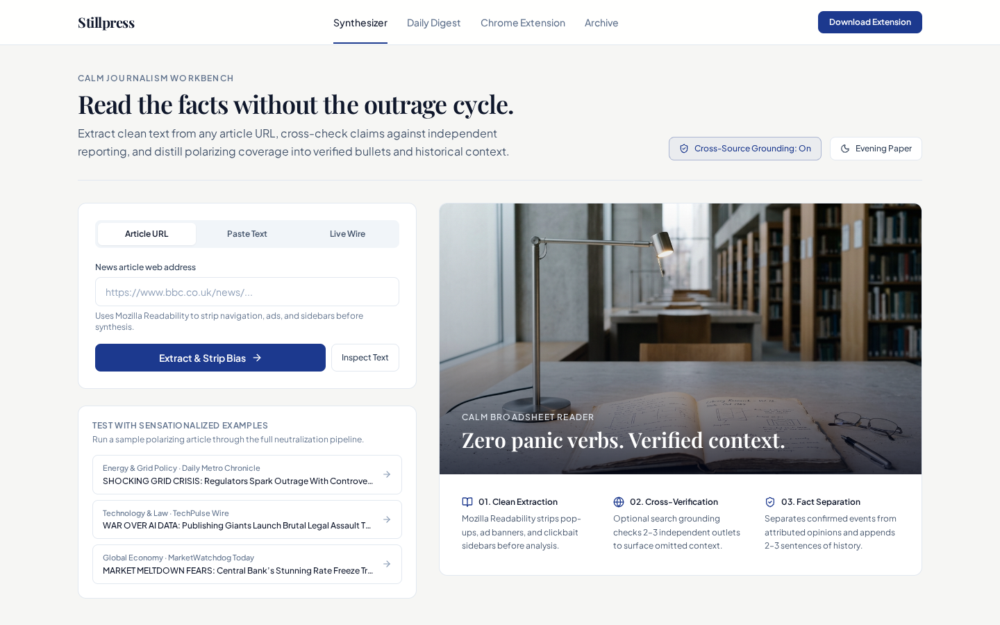
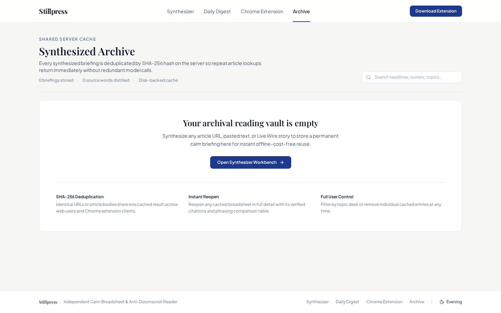

# Stillpress — AI-Powered Anti-Doomscroll News Synthesizer

I built **Stillpress** to transform polarizing, sensationalist news cycles into calm, structured factual briefings. Instead of exposing readers to outrage headlines, infinite scroll feeds, and ad clutter, Stillpress extracts clean article prose, cross-checks claims against independent reporting, strips emotionally charged language, and delivers a focused broadsheet summary across three channels: a **Web Broadsheet Reader**, a **Once-a-Day RSS Digest**, and a **Manifest V3 Chrome Extension**.


---

## Visual Tour & Complete Feature Breakdown

Every screenshot in `docs/images/` was captured directly from the live running Stillpress application (`http://localhost:3000`).

### 1. Calm Journalism Workbench (`Synthesizer`)


**What it does & how I built it:**
- **Three Input Modes**: Readers can paste any **Article URL**, switch to **Paste Text** (with `Ctrl/⌘ + Enter` submit for paywalled articles), or pick breaking stories from the **Live Wire** RSS tab.
- **Sensationalized Sample Presets**: Three built-in polarizing news articles allow immediate one-click verification of bias stripping, fact-vs-opinion separation, and historical context.
- **Cross-Source Grounding Toggle**: Enables or disables live search verification against independent outlets before generating the final briefing.
- **Calm Broadsheet Output (`src/components/BroadsheetReport.tsx`)**: Renders **01. Core Verified Facts**, **02. Claims & Differing Perspectives** (requiring explicit attribution), **03. Historical Context**, **04. Cross-Source Verification** citations, a collapsible **Sensationalism Stripped** phrasing comparison table, deterministic word-count reduction (`original words → briefing words`), Plain-Text/Markdown copy, and `@media print` **Print / Save PDF** export.

---

### 2. Live Mozilla Readability Extraction (`Inspect Text`)


**What it does & how I built it (`server/extractor.ts`):**
- Clicking **Inspect Text** calls `POST /api/extract`, validating the URL (blocking `localhost`, loopback, and private RFC-1918/link-local IPv4/IPv6 ranges against SSRF), fetching HTML with a 12-second timeout, parsing the DOM via `jsdom`, and running `@mozilla/readability` (Firefox Reader View's engine).
- Menus, pop-ups, and ad sidebars are stripped away, returning clean article prose (shown above extracting **563 clean words** from a live BBC News report) that can be sent directly into the editor.
- When publishers return HTTP `401`, `403`, `405`, `406`, or `429` bot-blocker responses, Stillpress displays a clear fallback guiding the user to **Paste Text** or the **Chrome Extension** running inside their own authenticated browser tab.

---

### 3. Live RSS Wire Aggregation


**What it does & how I built it (`server/rss.ts`):**
- Aggregates live headlines via `rss-parser` across four editorial desks: **World** (BBC World, NPR World), **Technology** (Ars Technica, Hacker News), **Science** (ScienceDaily, NASA Breaking), and **Business & Policy** (BBC Business, NPR Politics).
- Stories are HTML-sanitized, deduplicated by canonical link, sorted chronologically, and cached in memory for 10 minutes. Clicking any headline immediately runs extraction and synthesis.

---

### 4. Daily Calm Digest & Live Edition Preview Queue


**What it does & how I built it (`src/components/DailyDigestView.tsx` & `server/gemini.ts`):**
- Replaces continuous doomscrolling with a single daily morning edition capped at **1–7 stories**.
- As you select stories in the **Live RSS Queue**, the right-hand **Edition Preview Queue** updates live with numbered story previews.
- Compiling calls `POST /api/digest` to produce a two-sentence overview plus per-story **Core Facts**, **Perspectives**, and **Historical Context**, exportable as **Broadsheet View**, **Plain-Text Email View**, `.txt` download, or printable PDF.

---

### 5. Automated 8:00 AM Daily Digest Cron Workflow


**What it does & how I built it (`src/components/DailyDigestView.tsx`):**
- Clicking **Cron Automation Setup** reveals production-ready scheduling templates using repository secrets (`STILLPRESS_URL`, `RESEND_API_KEY`, `DIGEST_TO_EMAIL`):
  - **`.github/workflows/daily-digest.yml`**: Scheduled GitHub Actions job (`0 13 * * *`) that fetches `POST /api/digest` with `curl -sf` and emails `plainTextEmail` via Resend.
  - **`stillpress-digest-cron.mjs`**: Standalone Node script for VPS `cron` or Cloud Scheduler.
- Includes one-click **Copy** and **Download `.yml` / `.mjs`** buttons directly inside the UI.

---

### 6. Manifest V3 Chrome Extension Packager & Browser Simulator


**What it does & how I built it (`server/extensionBuilder.ts` & `src/components/ExtensionBuilderView.tsx`):**
- **One-Click ZIP Packaging**: `GET /api/extension/download` uses `jszip` to bundle `manifest.json`, `popup.html`, `popup.css`, `popup.js`, `README.txt`, and the full `Readability.js` script straight from `node_modules/@mozilla/readability/Readability.js`—pre-wired to the active server origin.
- **Paywall Bypass & Key Protection**: Inside `popup.js`, `chrome.scripting.executeScript` injects `Readability.js` directly into the user's already-loaded browser tab and sends only extracted prose to `POST /api/synthesize` (CORS-enabled for `chrome-extension://` origins). No API keys ever ship in the extension.
- **Browser-Framed Simulator & Code Inspector**: Test the 400px popup workflow right inside a simulated browser bar and inspect or copy every generated file.

---

### 7. Shared Server Synthesis Vault (`Archive`)


**What it does & how I built it (`server/gemini.ts` & `src/components/ArchiveView.tsx`):**
- To eliminate redundant LLM API costs when multiple users synthesize the same trending news story, every completed briefing is hashed via `SHA-256` (from canonical URL or text prefix + grounding toggle) and persisted to `.cache/syntheses.json`.
- Provides live search, topic-desk filters, tabular compression totals, one-click reopen into the broadsheet reader, and entry deletion (`DELETE /api/archive/:id`).

---

### 8. Evening Paper Dark Mode & Mobile Broadsheet
| Evening Paper (Dark Reading Mode) | Mobile Responsive Layout (`390px`) |
| :---: | :---: |
|  |  |

**What it does & how I built it (`src/index.css` & `src/App.tsx`):**
- Built with Tailwind CSS v4 `@custom-variant dark` pairing cool stone archival daylight (`#F6F6F4`) with low-glare evening slate (`#111315`), persisted in `localStorage` and accessible from both the workspace toolbar and global footer.
- Paired `Playfair Display` headlines with `Plus Jakarta Sans` UI/prose and `IBM Plex Mono` tabular numerals.

---

## Architecture & Engineering Highlights

1. **Two-Stage Grounding + Structured Schema (`server/gemini.ts`)**: When Cross-Source Grounding is enabled, Stage 1 queries `gemini-4-hydrogen` with `{ tools: [{ googleSearch: {} }] }` to gather corroborating reports and extract real `groundingChunks` citations. Stage 2 synthesizes the primary article alongside those findings under strict JSON `responseSchema` enforcement (`Type.OBJECT`), preventing unstructured drift.
2. **Explicit Fact vs. Claim Separation**: Prompts and schema properties strictly separate verified events (`coreFacts`) from attributed disputes (`differingPerspectives`), append 2–3 sentences of historical background, and capture exact phrasing neutralizations (`neutralizedPhrases`).
3. **Zero Client Key Exposure**: `GEMINI_API_KEY` stays strictly server-side (`process.env.GEMINI_API_KEY`), protecting both the web app and the distributed Chrome extension.

---

## Backend API Reference

| Method | Endpoint | Purpose |
| :--- | :--- | :--- |
| `GET` | `/api/health` | Service health check returning `{ ok: true, service: "stillpress" }` |
| `POST` | `/api/extract` | Extracts clean article text and metadata from `{ url }` via Readability |
| `POST` | `/api/synthesize` | Runs the 4-step pipeline from `{ url }` or `{ text, title, siteName, crossVerify }` |
| `GET` | `/api/rss?category=...` | Fetches live RSS headlines (`all`, `world`, `technology`, `science`, `policy`) |
| `POST` | `/api/digest` | Compiles selected RSS items into a calm morning edition & plain-text email |
| `GET` | `/api/archive` | Lists cached briefings stored in `.cache/syntheses.json` |
| `DELETE` | `/api/archive/:id` | Removes a cached briefing by ID |
| `GET` | `/api/extension/files` | Returns generated Manifest V3 source files pre-wired to the server origin |
| `GET` | `/api/extension/download` | Streams `stillpress-chrome-extension.zip` bundling `Readability.js` |

---

## Complete Deployment Guide (Server, Chrome Extension & Daily Digest)

### Part 1 — Deploy the Stillpress Backend Server (Required First)

Deploy the Node.js + Express backend first to a public HTTPS host (Google Cloud Run, Railway, Render, Fly.io, or a VPS) so the Chrome extension never holds an API key:

1. **Set Environment Variables** on your host:
   - `GEMINI_API_KEY`: Your Gemini API key.
   - `APP_URL`: Your public HTTPS URL (e.g., `https://stillpress.yourdomain.com`). `/api/extension/download` embeds this URL into `manifest.json` (`host_permissions`) and `popup.js` (`STILLPRESS_API_BASE`).
   - `NODE_ENV`: `production`
2. **Build & Start**:
   ```bash
   npm install
   npm run build    # Compiles React/Vite frontend into dist/
   npm start        # Runs Express server on port 3000 (node server.ts)
   ```
3. **Verify Health**:
   ```bash
   curl https://your-deployed-domain.com/api/health
   # Expected: {"ok":true,"service":"stillpress"}
   ```

---

### Part 2 — Deploy the Chrome Extension (Two Options)

#### Option A: Personal or Team Install (Developer Mode / Load Unpacked)
1. Open your deployed Stillpress web app (`https://your-deployed-domain.com`) and go to the **Chrome Extension** tab.
2. Click **Download Extension (.zip)** (`GET /api/extension/download`). The downloaded package is automatically pre-wired to your HTTPS backend.
3. Extract `stillpress-chrome-extension.zip` into a permanent folder.
4. Open `chrome://extensions` in Chrome, Brave, Arc, or Edge and enable **Developer mode**.
5. Click **Load unpacked**, select the extracted folder, pin **Stillpress**, and click the icon on any open news article.

#### Option B: Public Release on the Chrome Web Store
1. **Download Production ZIP**: Download from `https://your-deployed-domain.com/api/extension/download` so `popup.js` uses HTTPS (`chrome://` store review rejects `http://localhost` production endpoints).
2. **Add Extension Icons**: Place `16×16`, `48×48`, and `128×128` PNG icons in `icons/` and add `"icons"` to `manifest.json`:
   ```json
   "icons": {
     "16": "icons/icon16.png",
     "48": "icons/icon48.png",
     "128": "icons/icon128.png"
   }
   ```
3. **Minimal Permissions Advantage**: Stillpress uses only `activeTab`, `scripting`, `storage`, and a single `host_permissions` entry for your backend (`https://your-deployed-domain.com/*`)—avoiding broad `<all_urls>` warnings during review.
4. **Package & Upload**: Re-zip the folder with `manifest.json` at the root, upload it in the [Chrome Web Store Developer Dashboard](https://chrome.google.com/webstore/devconsole), and submit with:
   - **Single Purpose**: *"Extracts article prose from the user's active tab on click and renders a neutral, factual news briefing."*
   - **Permission Justifications**: Explain `activeTab`/`scripting` (on-click Readability extraction) and `host_permissions` (sending extracted prose to your backend API for synthesis).

---

### Part 3 — Deploy Automated 8:00 AM Daily Digest (GitHub Actions + Resend)

1. In your GitHub repository (**Settings → Secrets and variables → Actions**), add:
   - `STILLPRESS_URL`: `https://your-deployed-domain.com`
   - `RESEND_API_KEY`: Your Resend API key
   - `DIGEST_TO_EMAIL`: Recipient email address
2. Download `.github/workflows/daily-digest.yml` directly from the **Daily Digest → Cron Automation Setup** panel in Stillpress and commit it to `.github/workflows/daily-digest.yml`.

---

## Local Development Commands

```bash
npm install      # Install dependencies
npm run dev      # Start Express + Vite dev server on http://localhost:3000
npm run lint     # Type-check TypeScript (tsc --noEmit)
npm run build    # Build production bundle into dist/
npm start        # Run production server (node server.ts)
```
