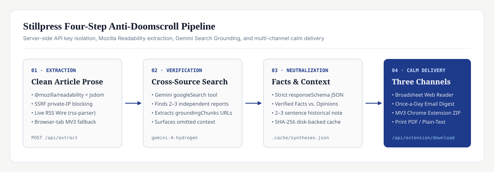
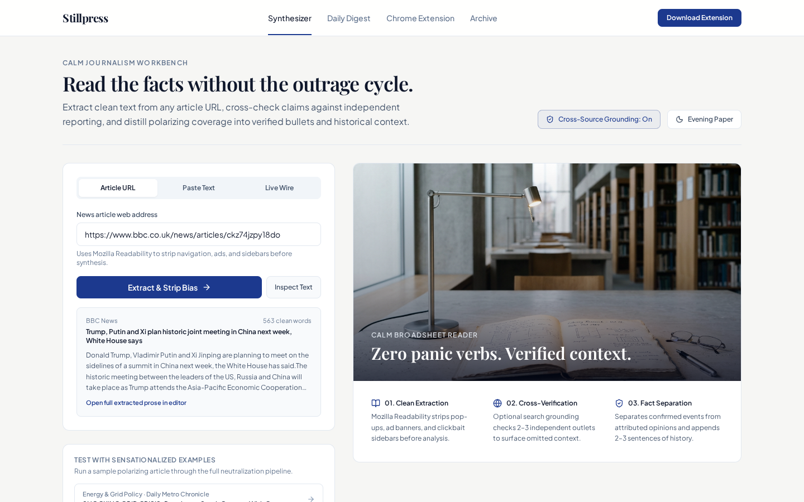
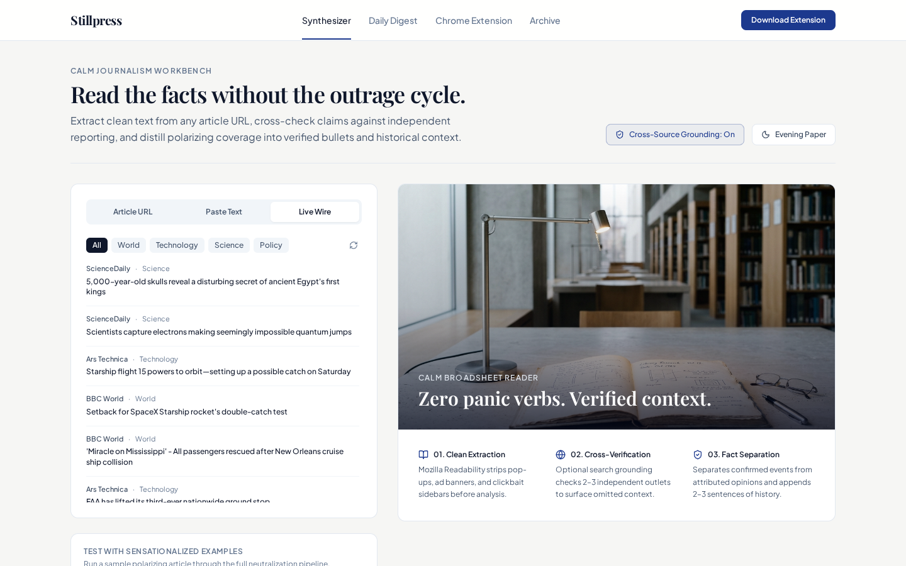
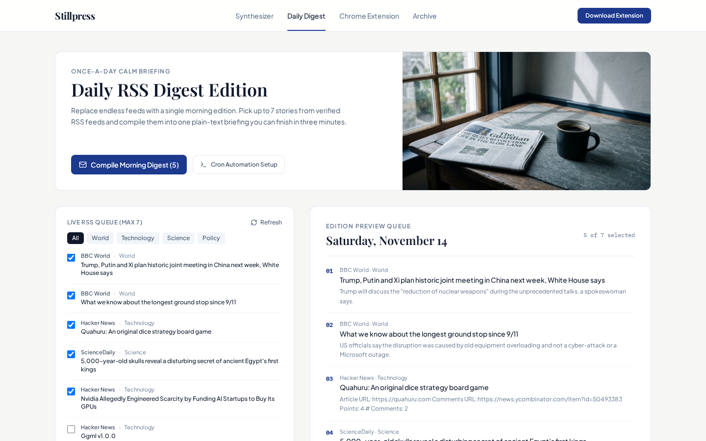
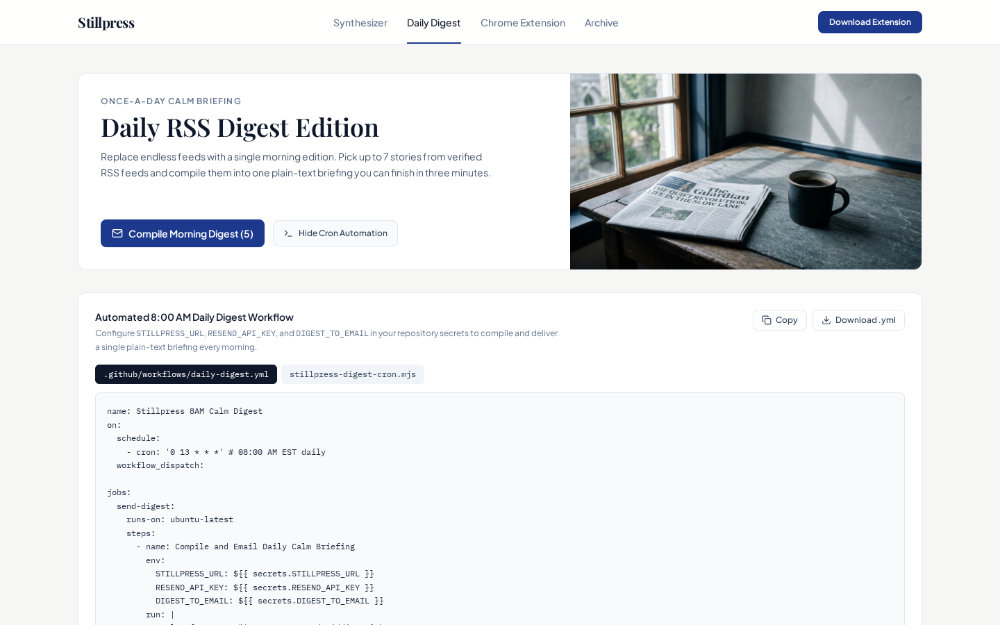
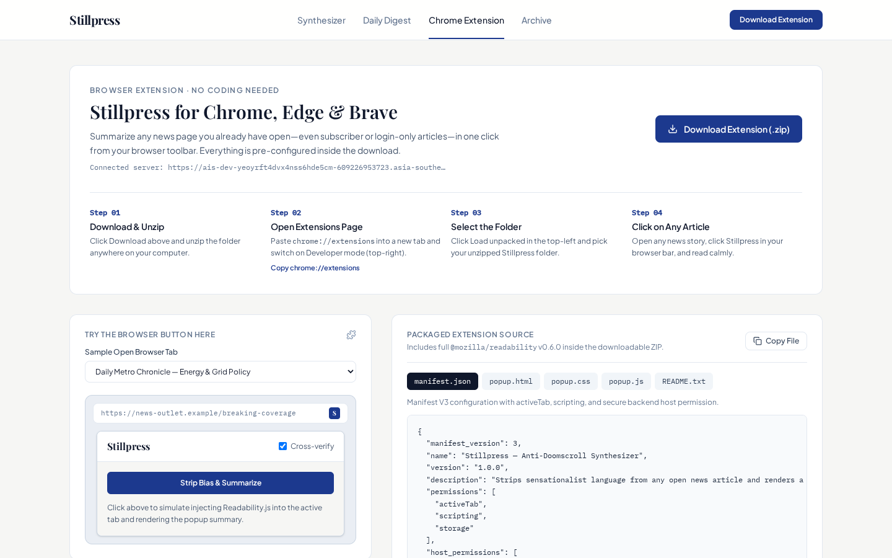

# Stillpress — AI-Powered Anti-Doomscroll News Synthesizer

I built **Stillpress** to transform polarizing, sensationalist news cycles into calm, structured factual briefings. Instead of exposing readers to outrage headlines, infinite scroll feeds, and ad clutter, Stillpress extracts clean article prose, cross-checks claims against independent reporting, strips emotionally charged language, and delivers a focused broadsheet summary across three channels:

1. **Web Broadsheet Reader** — Paste any link, raw article text, or live wire headline to generate a calm, print-ready briefing.
2. **Once-a-Day RSS Digest** — Compile up to 7 stories into a 3-minute morning briefing or schedule an automated 8:00 AM plain-text email.
3. **Manifest V3 Chrome Extension** — Summarize articles directly inside your active Chrome, Edge, Brave, or Arc tab (bypassing server bot blockers and client-side paywalls with zero API keys stored in browser code).



---

## Table of Contents

1. [Tech Stack & Dependencies](#tech-stack--dependencies)
2. [Complete File & Directory Structure](#complete-file--directory-structure)
3. [Visual Tour & Feature Breakdown](#visual-tour--feature-breakdown)
4. [Four-Step Pipeline Deep Dive](#four-step-pipeline-deep-dive)
5. [Backend API Reference & Example Payloads](#backend-api-reference--example-payloads)
6. [Chrome Extension (Manifest V3) Internals](#chrome-extension-manifest-v3-internals)
7. [Environment Variables & Security Model](#environment-variables--security-model)
8. [Local Setup & Development](#local-setup--development)
9. [Complete Deployment Guide (Server, Extension & 8 AM Email Cron)](#complete-deployment-guide-server-extension--8-am-email-cron)
10. [Troubleshooting](#troubleshooting)

---

## Tech Stack & Dependencies

| Layer | Technology | Version / Role |
| :--- | :--- | :--- |
| **Frontend** | React + TypeScript + Vite | React `^19.0.1`, Vite `^8.3.0`, TypeScript `^7.0.2`, `lucide-react` icons |
| **Styling & Typography** | Tailwind CSS v4 (`@tailwindcss/vite`) | `^4.3.3` with custom `@theme` tokens (`Playfair Display`, `Plus Jakarta Sans`, `IBM Plex Mono`), Daylight & Evening Paper dark mode, and `@media print` broadsheet styles |
| **Backend Server** | Node.js + Express (`server.ts`) | Express `^4.21.2`, `tsx` (`^4.21.0`) for dev middleware mode and standalone production serving (`dist/`) |
| **Article Extraction** | `@mozilla/readability` + `jsdom` | Readability `^0.6.0` (Firefox Reader View engine) + JSDOM `^31.0.1` |
| **RSS Aggregation** | `rss-parser` | `^3.13.0` parsing 8 live global news, tech, science, and policy feeds with 10-minute memory caching |
| **AI Synthesis & Search** | `@google/genai` | `^3.3.0` (`gemini-4-hydrogen`) with Google Search grounding + strict JSON `responseSchema` enforcement |
| **Extension Packager** | `jszip` | `^3.10.2` streaming downloadable `stillpress-chrome-extension.zip` pre-configured for the host origin |

---

## Complete File & Directory Structure

Every source file, backend module, static asset, and documentation screenshot in the repository:

```text
stillpress/
├── .env.example                           # Environment variable template (GEMINI_API_KEY, APP_URL)
├── .gitignore                             # Excludes node_modules, dist, .env, and .cache/
├── index.html                             # HTML entry point with Google Fonts & OpenGraph metadata
├── metadata.json                          # Applet metadata & server-side Gemini capability declaration
├── package.json                           # Scripts (dev, build, start, lint) and dependencies
├── tsconfig.json                          # TypeScript compiler configuration
├── vite.config.ts                         # Vite + React + Tailwind v4 build config
├── server.ts                              # Express HTTP server, CORS extension bridge, API routes & Vite/static serving
│
├── server/                                # Backend pipeline modules (Node.js / TypeScript)
│   ├── extractor.ts                       # URL validation, SSRF IP blocker, HTTP fetcher, JSDOM + Readability parser
│   ├── rss.ts                             # 8-source RSS wire aggregator, HTML sanitizer, link deduplicator & 10m cache
│   ├── gemini.ts                          # Two-stage Gemini grounding + structured JSON synthesis, digest builder & disk vault
│   └── extensionBuilder.ts                # Generates Manifest V3 extension files & zips them with Readability.js
│
├── src/                                   # Frontend React application
│   ├── main.tsx                           # React root mount
│   ├── App.tsx                            # Root navigation shell, theme switcher (Daylight / Evening), global footer
│   ├── index.css                          # Tailwind v4 theme tokens, dark-mode variant, print CSS & reduced-motion rules
│   ├── types/
│   │   └── news.ts                        # Shared TypeScript interfaces (SynthesisResult, DailyDigestResult, RssArticleItem, etc.)
│   ├── data/
│   │   └── samples.ts                     # 3 built-in sensationalized sample articles for 1-click testing
│   ├── assets/images/                     # Local editorial photography assets bundled by Vite
│   │   ├── archival_reading_lamp_*.jpg    # Workbench editorial card photography
│   │   └── calm_broadsheet_desk_*.jpg     # Daily Digest banner photography
│   └── components/
│       ├── Header.tsx                     # 3-zone top bar navigation + mobile tab strip + extension download trigger
│       ├── SynthesizerWorkspace.tsx       # Article Link, Paste Text, Headlines tabs, clipboard paste & 1-click sample cards
│       ├── BroadsheetReport.tsx           # Structured calm report, text size toggle, phrasing diff table, copy & PDF print
│       ├── DailyDigestView.tsx            # RSS multi-story picker (max 7), live preview queue, email/txt export & cron templates
│       ├── ExtensionBuilderView.tsx       # 4-step install guide, live popup simulator & source code inspector
│       └── ArchiveView.tsx                # Saved Briefings vault with search, topic desk filters & instant reopen
│
└── docs/images/                           # Live application screenshots & architecture diagram
    ├── pipeline_architecture.svg          # 4-step pipeline architecture diagram
    ├── 01_synthesizer_workbench.png       # Main calm journalism workbench
    ├── 02_daily_digest_rss.png            # Daily Digest live RSS queue & Edition Preview Queue
    ├── 03_chrome_extension_builder.png    # Manifest V3 Chrome Extension packager & browser simulator
    ├── 04_archive_view.png                # Saved Briefings archive view
    ├── 05_live_rss_wire.png               # Live RSS Headlines tab inside the workbench
    ├── 06_evening_paper_dark.png          # Evening Paper dark reading theme
    ├── 07_readability_extraction_live.png # Live BBC News prose extraction via Readability
    ├── 08_mobile_responsive.png           # Responsive mobile layout (390px viewport)
    └── 09_daily_digest_cron.png           # Automated 8:00 AM GitHub Actions & Resend workflow viewer
```

---

## Visual Tour & Feature Breakdown

All screenshots in `docs/images/` were captured directly from the live running Stillpress application (`http://localhost:3000`).

### 1. Calm Journalism Workbench (`Synthesizer`)


**Files:** `src/components/SynthesizerWorkspace.tsx`, `src/components/BroadsheetReport.tsx`, `src/data/samples.ts`

- **Three Input Modes**:
  1. **Article Link**: Paste any public article URL (with a one-click **Paste from clipboard** button) to clean and summarize automatically.
  2. **Paste Text**: Paste article text directly (supports `Ctrl/⌘ + Enter` keyboard submission) for paywalled or login-gated stories.
  3. **Headlines**: Browse live stories pulled from trusted international RSS feeds and summarize any headline with one click.
- **One-Click Sample Presets (`Try a Dramatic Story`)**: Three built-in sensationalized stories (`Energy & Grid Policy`, `Technology & Law`, `Global Economy`) let anyone verify bias removal immediately without external setup.
- **Check Multiple Outlets Toggle**: Controls whether Stage 1 cross-source verification queries live search reporting before generating the briefing.
- **Structured Broadsheet Report (`BroadsheetReport.tsx`)**:
  - **01. Key Facts**: 3–5 verified, matter-of-fact bullet points.
  - **02. Different Viewpoints**: Balanced, explicitly attributed perspectives contrasting competing claims (e.g., *"Officials stated X, while independent analysts argued Y"*).
  - **03. Background History**: 2–3 calm sentences explaining the historical context leading up to the event.
  - **04. What Other Outlets Report**: Grounded citation links retrieved from cross-source verification.
  - **Emotional Words Removed**: Expandable comparison table pairing each **Dramatic Original Phrase** with its **Calm Version**.
  - **Reader Comfort & Export**: Includes a **Larger Text / Standard Text** font-size toggle, deterministic word count comparison (`original words → briefing words`), **Copy Text**, **Copy Markdown**, and `@media print` **Print / Save PDF**.

---

### 2. Live Mozilla Readability Extraction (`Preview Text`)


**Files:** `server/extractor.ts`, `src/components/SynthesizerWorkspace.tsx`

- Clicking **Preview Text** sends the URL to `POST /api/extract` before running AI synthesis so readers can inspect the clean prose first.
- `server/extractor.ts` validates the URL, blocks loopback/private network hosts (SSRF protection), fetches HTML with a 12-second `AbortController` timeout, builds a DOM via `jsdom`, and runs `@mozilla/readability`.
- Navigation menus, cookie pop-ups, and ad banners are stripped away, returning clean article text (demonstrated above extracting **563 clean words** from a live BBC News report) with an **Open full extracted prose in editor** option.
- If a publisher returns HTTP `401`, `403`, `405`, `406`, or `429` bot-blocker responses, Stillpress returns a clear message guiding the reader to **Paste Text** or the **Chrome Extension** running inside their own authenticated browser tab.

---

### 3. Live RSS Headlines Wire


**Files:** `server/rss.ts`, `src/components/SynthesizerWorkspace.tsx`

- Aggregates live RSS XML feeds via `rss-parser` across four editorial desks (`World`, `Technology`, `Science`, `Policy`):
  - **World**: BBC World (`feeds.bbci.co.uk/news/world/rss.xml`), NPR World (`feeds.npr.org/1004/rss.xml`)
  - **Technology**: Ars Technica (`feeds.arstechnica.com/arstechnica/index`), Hacker News (`hnrss.org/frontpage`)
  - **Science**: ScienceDaily (`sciencedaily.com/rss/top/science.xml`), NASA Breaking (`nasa.gov/rss/dyn/breaking_news.rss`)
  - **Policy & Business**: BBC Business (`feeds.bbci.co.uk/news/business/rss.xml`), NPR Politics (`feeds.npr.org/1014/rss.xml`)
- Items are stripped of raw HTML snippets, deduplicated by canonical URL, sorted newest-first, and cached in memory for 10 minutes. Clicking any headline extracts and summarizes it automatically.

---

### 4. Daily Calm Digest & Live Edition Preview Queue


**Files:** `src/components/DailyDigestView.tsx`, `server/gemini.ts`

- Designed to stop infinite scrolling by capping each daily edition at **1–7 stories** designed for a calm 3-minute morning read.
- Under **Pick Up to 7 Stories**, readers filter by desk (`All`, `World`, `Technology`, `Science`, `Policy`) and toggle stories while the **Edition Preview Queue** updates live on the right with numbered cards.
- Clicking **Compile Morning Digest** invokes `POST /api/digest` to generate a two-sentence overview plus per-story **Key Facts**, **Different Viewpoints**, and **Background History**.
- Switch cleanly between **Broadsheet View**, **Email View** (formatted plain text), `.txt` file download, one-click clipboard copy, and **Print / Save PDF**.

---

### 5. Automated 8:00 AM Daily Digest Cron Workflow


**Files:** `src/components/DailyDigestView.tsx`

- Clicking **Schedule 8 AM Email** reveals ready-to-use scheduling templates wired to environment secrets (`STILLPRESS_URL`, `RESEND_API_KEY`, `DIGEST_TO_EMAIL`):
  - **`.github/workflows/daily-digest.yml`**: GitHub Actions workflow scheduled at `0 13 * * *` (8:00 AM EST daily) that calls `POST /api/digest` with `curl -sf` and dispatches the plain-text morning briefing via Resend.
  - **`stillpress-digest-cron.mjs`**: Standalone Node script ready for Linux `crontab`, Railway Cron, or Cloud Scheduler.
- Both templates include one-click **Copy** and **Download `.yml` / `.mjs`** buttons directly inside the web app.

---

### 6. Manifest V3 Chrome Extension Packager & Browser Simulator


**Files:** `server/extensionBuilder.ts`, `src/components/ExtensionBuilderView.tsx`

- **One-Click ZIP Packaging (`GET /api/extension/download`)**: Uses `jszip` to package a complete, ready-to-load Manifest V3 extension (`stillpress-chrome-extension.zip`) containing `manifest.json`, `popup.html`, `popup.css`, `popup.js`, `README.txt`, and the full `@mozilla/readability` `Readability.js` script from `node_modules`.
- **Pre-Wired Backend Origin**: Automatically embeds your running server's origin into `manifest.json` (`host_permissions`) and `popup.js` (`STILLPRESS_API_BASE`), keeping your Gemini API key completely off the user's browser.
- **Try the Browser Button Here**: Interactive 400px popup simulator inside a browser toolbar frame lets visitors test the extension flow immediately from the web UI, alongside a tabbed source inspector and one-click `Copy chrome://extensions` helper.

---

### 7. Saved Briefings Vault (`Archive`)


**Files:** `src/components/ArchiveView.tsx`, `server/gemini.ts`

- Completed briefings are persisted on the server in `.cache/syntheses.json` (up to the 60 most recent entries, sorted chronologically) so readers can revisit past summaries immediately without waiting or re-running synthesis.
- **Instant Reopen**: Reopen any saved broadsheet in full detail with its verified citations and phrasing comparison table.
- **Full User Control**: Filter by topic desk, search across headlines and outlets, or remove individual saved entries at any time (`DELETE /api/archive/:id`).

---

### 8. Evening Paper Dark Mode & Mobile Responsive Broadsheet
| Evening Paper (Dark Reading Mode) | Mobile Responsive Layout (`390px`) |
| :---: | :---: |
|  |  |

**Files:** `src/index.css`, `src/App.tsx`, `src/components/Header.tsx`

- Uses Tailwind CSS v4 `@custom-variant dark` to switch smoothly between low-glare **Daylight Paper** (`#F6F6F4`) and **Evening Paper** (`#111315`), persisted in `localStorage` (`stillpress-theme`) and accessible from both the workspace bar and global footer.
- Mobile view (`390px`) stacks the 3-zone header with a clean horizontal navigation bar and touch-friendly controls without overflow or clipped typography.

---

## Four-Step Pipeline Deep Dive

1. **Step 1 — Content Extraction (`server/extractor.ts` & `popup.js`)**
   - *Web App*: Fetches target HTML with standard browser headers, enforces SSRF protections, parses DOM with `jsdom`, and runs `@mozilla/readability` to strip ads, pop-ups, and navigation chrome (capped at 15,000 characters).
   - *Chrome Extension*: Injects `Readability.js` directly into the user's active tab via `chrome.scripting.executeScript` so authenticated, subscriber, or bot-protected pages extract smoothly inside the reader's own session.
2. **Step 2 — Cross-Source Verification (`server/gemini.ts`)**
   - When **Check Multiple Outlets** is enabled, Stage 1 calls `gemini-4-hydrogen` with `{ tools: [{ googleSearch: {} }] }` and `ThinkingLevel.LOW` to retrieve 2–3 independent news reports covering the same event and extracts verified `groundingChunks` titles and URLs.
3. **Step 3 — Neutralization & Context (`server/gemini.ts`)**
   - Stage 2 combines the extracted prose and corroborating findings under strict system instructions and JSON `responseSchema` (`Type.OBJECT`), enforcing separation between `coreFacts` (verified events), `differingPerspectives` (attributed disputes), `historicalContext` (2–3 sentences), and `neutralizedPhrases` (dramatic vs. calm phrasing pairs).
4. **Step 4 — Calm Delivery (`BroadsheetReport.tsx`, `DailyDigestView.tsx`, `popup.js`)**
   - Renders clean, calm typography with copy/print exports, once-a-day 8 AM email scheduling, and a 400px extension popup.

---

## Backend API Reference & Example Payloads

All routes are mounted in `server.ts` on port `3000`. Extension CORS headers automatically allow `chrome-extension://*` and `moz-extension://*` origins.

| Method | Endpoint | Request Body / Query | Response Shape |
| :--- | :--- | :--- | :--- |
| `GET` | `/api/health` | — | `{ ok: true, service: "stillpress" }` |
| `POST` | `/api/extract` | `{ url: string }` | `{ text: string, meta: ExtractedMeta }` |
| `POST` | `/api/synthesize` | `{ url?, text?, title?, siteName?, byline?, crossVerify?: boolean }` | `SynthesisResult` |
| `GET` | `/api/rss` | `?category=all\|world\|technology\|science\|policy` | `{ items: RssArticleItem[], sourcesChecked, failedSources }` |
| `POST` | `/api/digest` | `{ articles?: RssArticleItem[] }` *(defaults to top 6 live wire items if omitted)* | `DailyDigestResult` (`editionDate`, `overview`, `briefings`, `plainTextEmail`, `latencyMs`) |
| `GET` | `/api/archive` | — | `{ items: SynthesisResult[] }` |
| `DELETE` | `/api/archive/:id` | `:id` path parameter | `{ removed: boolean }` |
| `GET` | `/api/extension/files` | — | `{ origin: string, files: ExtensionFileEntry[] }` |
| `GET` | `/api/extension/download` | — | Binary `application/zip` (`stillpress-chrome-extension.zip`) |

### Quick Endpoint Verification (`curl`)

```bash
# 1. Health check
curl http://localhost:3000/api/health

# 2. Test live Mozilla Readability extraction
curl -X POST http://localhost:3000/api/extract \
  -H "Content-Type: application/json" \
  -d '{"url":"https://www.bbc.com/news/world"}'

# 3. Fetch aggregated RSS headlines
curl "http://localhost:3000/api/rss?category=technology"

# 4. Download the packaged Manifest V3 Chrome extension
curl -o stillpress-chrome-extension.zip http://localhost:3000/api/extension/download
```

---

## Chrome Extension (Manifest V3) Internals

Downloaded via `GET /api/extension/download`, the ZIP contains **6 ready-to-load files**:

| File | Role |
| :--- | :--- |
| `manifest.json` | Declares `"manifest_version": 3`, minimal permissions (`["activeTab", "scripting", "storage"]`), and `"host_permissions"` scoped strictly to your Stillpress backend origin (no broad `<all_urls>` access). |
| `Readability.js` | Official `@mozilla/readability` script copied directly from `node_modules/@mozilla/readability/Readability.js`. |
| `popup.html` | Clean 400px popup shell featuring the **Cross-verify** checkbox, **Strip Bias & Summarize** button, and structured result sections. |
| `popup.css` | Archival broadsheet styling (`#f6f6f4` paper canvas, serif headline, clean spacing). |
| `popup.js` | Queries the active tab, injects `Readability.js` + parser via `chrome.scripting.executeScript`, slices clean prose (`14,000` chars), and posts to `${STILLPRESS_API_BASE}/api/synthesize`. |
| `README.txt` | Plain-English quick-start instructions for loading unpacked in Chrome/Edge/Brave Developer Mode. |

---

## Environment Variables & Security Model

Defined in `.env.example`:

```env
# Required for server-side Gemini synthesis & Google Search grounding
GEMINI_API_KEY="YOUR_GEMINI_API_KEY"

# Public base URL where Stillpress is hosted (used to pre-wire Chrome extension downloads)
APP_URL="https://your-deployed-domain.com"
```

### Security Protections Built In
- **Zero Client API Key Exposure**: `GEMINI_API_KEY` is read exclusively in `server/gemini.ts` (`process.env.GEMINI_API_KEY`). Neither the React frontend nor the downloadable Chrome extension ever handles or ships an API key.
- **SSRF Network Filtering (`server/extractor.ts`)**: Rejects non-HTTP(S) protocols and blocks `localhost`, `0.0.0.0`, `.local`, `.internal`, IPv4 private/loopback/link-local ranges (`10.x`, `127.x`, `169.254.x`, `172.16–31.x`, `192.168.x`), and IPv6 loopback/ULA/link-local addresses (`::1`, `fc*`, `fd*`, `fe80*`).
- **Scoped Extension Permissions**: The Chrome extension requests only `activeTab` and `scripting` (running solely when the user explicitly clicks the toolbar icon).

---

## Local Setup & Development

### Prerequisites
- **Node.js 20+** (tested on Node `v22.23.2`)
- A valid **Gemini API key** from Google AI Studio

### Install & Run

```bash
# 1. Install dependencies
npm install

# 2. Configure environment variables
cp .env.example .env
# Edit .env and set GEMINI_API_KEY="your-key"

# 3. Start full-stack dev server (Express API + Vite SPA on http://localhost:3000)
npm run dev
```

### Available npm Scripts

```bash
npm run dev      # Start Express + Vite middleware dev server on port 3000
npm run lint     # Run strict TypeScript check (tsc --noEmit)
npm run build    # Compile production React SPA bundle into dist/
npm start        # Run production Express server serving dist/ + /api/* on port 3000
npm run clean    # Remove dist/ and compiled server artifacts
```

---

## Complete Deployment Guide (Server, Extension & 8 AM Email Cron)

### Part 1 — Deploy the Stillpress Backend Server (Required First)

Deploy the Node.js + Express backend first to a public HTTPS host (Google Cloud Run, Railway, Render, Fly.io, or a VPS) so both the web app and the Chrome extension connect over HTTPS:

1. **Set Environment Variables** on your hosting platform:
   - `GEMINI_API_KEY`: Your Gemini API key.
   - `APP_URL`: Your public HTTPS URL (e.g., `https://stillpress.yourdomain.com`). `/api/extension/download` automatically embeds this URL into `manifest.json` and `popup.js`.
   - `NODE_ENV`: `production`
2. **Build & Start Commands**:
   - Build command: `npm install && npm run build`
   - Start command: `npm start` *(executes `node server.ts` on port `3000`)*
3. **Verify Live Deployment**:
   ```bash
   curl https://your-deployed-domain.com/api/health
   # Expected output: {"ok":true,"service":"stillpress"}
   ```

---

### Part 2 — Deploy the Chrome Extension

#### Option A: Personal or Team Install (Developer Mode / Load Unpacked)
1. Open your deployed Stillpress web app (`https://your-deployed-domain.com`) and navigate to the **Chrome Extension** tab.
2. Click **Download Extension (.zip)** (`GET /api/extension/download`). The downloaded ZIP is already wired to your live HTTPS server.
3. Extract `stillpress-chrome-extension.zip` into a permanent folder on your computer.
4. Open `chrome://extensions` in Chrome, Brave, Arc, or Microsoft Edge and toggle **Developer mode** ON in the top-right corner.
5. Click **Load unpacked**, select the extracted folder, pin **Stillpress** to your toolbar, and click it on any news article.

#### Option B: Public Release on the Chrome Web Store
1. **Download Production ZIP**: Download from `https://your-deployed-domain.com/api/extension/download` so `manifest.json` and `popup.js` use your HTTPS domain (Chrome Web Store rejects `http://localhost` production endpoints).
2. **Add Extension Icons**: Place `16×16`, `48×48`, and `128×128` PNG icons inside an `icons/` subfolder and add `"icons"` to `manifest.json`:
   ```json
   "icons": {
     "16": "icons/icon16.png",
     "48": "icons/icon48.png",
     "128": "icons/icon128.png"
   }
   ```
3. **Re-Zip & Submit**: Compress the folder contents (ensuring `manifest.json` is at the ZIP root), upload to the [Chrome Web Store Developer Dashboard](https://chrome.google.com/webstore/devconsole), and provide:
   - **Single Purpose Description**: *"Extracts article prose from the user's active tab on click and renders a calm, neutral factual news briefing."*
   - **Permission Justifications**:
     - `activeTab` & `scripting`: Injects `Readability.js` only when the user clicks the extension button to extract clean article text from the active tab.
     - `storage`: Saves user preferences (such as the Cross-verify toggle).
     - `host_permissions` (`https://your-deployed-domain.com/*`): Sends extracted article text to your Stillpress backend API for neutralization.

---

### Part 3 — Deploy Automated 8:00 AM Daily Digest (GitHub Actions + Resend)

1. In your GitHub repository, go to **Settings → Secrets and variables → Actions** and add:
   - `STILLPRESS_URL`: `https://your-deployed-domain.com`
   - `RESEND_API_KEY`: Your Resend API key
   - `DIGEST_TO_EMAIL`: Recipient email address
2. Open the **Daily Digest → Schedule 8 AM Email** panel inside Stillpress, download **`.github/workflows/daily-digest.yml`**, and commit it to `.github/workflows/daily-digest.yml` in your repository.
3. Trigger a manual test run from GitHub's **Actions** tab (`workflow_dispatch`) to receive your first calm morning briefing immediately.

---

## Troubleshooting

- **"Gemini API authentication failed"**: Ensure `GEMINI_API_KEY` is set in your `.env` file (local) or host secrets (production) and restart the server.
- **Publisher returns HTTP 401 / 403 / 405 / 429 on `Article Link`**: Some outlets aggressively block automated server scrapers or enforce paywalls. Copy the article text into the **Paste Text** tab, or run the **Chrome Extension** directly on the already-loaded browser tab.
- **Chrome Extension cannot reach server**: Confirm the extension ZIP was downloaded from your live HTTPS `APP_URL` (not `localhost` if your server is remote) and check that `/api/health` returns `{"ok":true,"service":"stillpress"}`.
