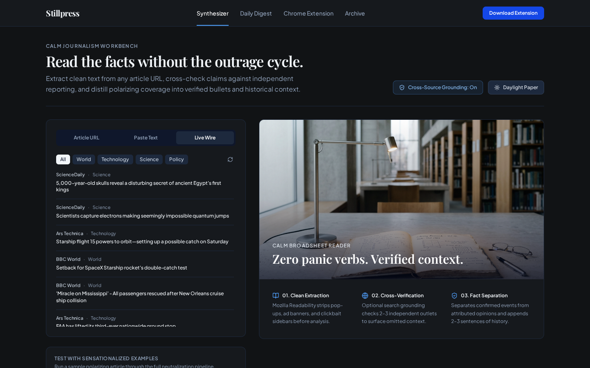
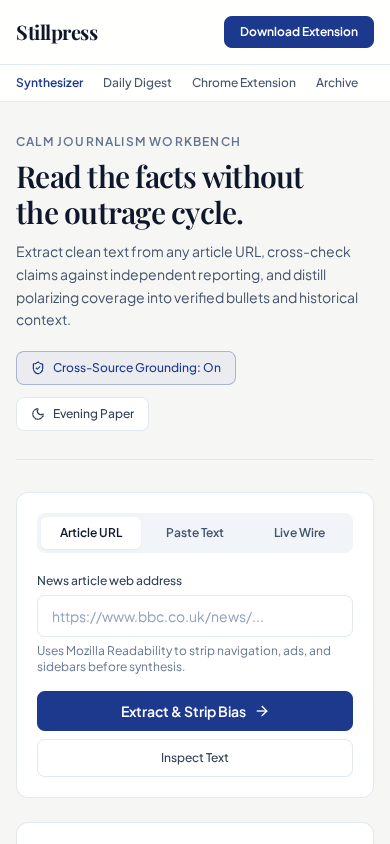

# Stillpress — AI-Powered Anti-Doomscroll News Synthesizer

I built **Stillpress** to turn polarizing, sensationalist news cycles into calm, structured factual briefings. Instead of exposing readers to outrage headlines, infinite scroll feeds, and ad clutter, Stillpress extracts clean article prose, cross-checks claims against independent reporting, strips emotionally charged language, and delivers a concise broadsheet summary across three channels: a **Web Broadsheet Reader**, a **Once-a-Day RSS Digest**, and a **Manifest V3 Chrome Extension**.


---

## Key Features & Proven Screenshots

Every screenshot below was captured directly from the live running application (`http://localhost:3000`).

### 1. Calm Journalism Workbench (`Synthesizer`)


**How it works:**
- **Three Input Modes**: Submit any **Article URL**, paste paywalled prose directly in **Paste Text**, or pick breaking stories from the **Live Wire** RSS tab.
- **One-Click Sensationalized Samples**: Three built-in polarizing news examples let anyone test bias-stripping and historical contextualization immediately.
- **Cross-Source Grounding Toggle**: Enables or disables live multi-outlet verification before generating the final briefing.

---

### 2. Live Mozilla Readability Extraction (`Inspect Text`)


**How I built it (`server/extractor.ts`):**
- When you submit a URL or click **Inspect Text**, the server validates the URL (blocking `localhost`, loopback, and private RFC-1918/link-local IP ranges to prevent SSRF), fetches the HTML with a 12-second timeout, parses the DOM with `jsdom`, and runs `@mozilla/readability` (the same engine behind Firefox Reader View).
- Navigation menus, pop-ups, and ad sidebars are stripped away, returning clean article prose (shown above extracting **563 clean words** from a live BBC News report) ready to edit or synthesize.
- If a publisher returns HTTP `401`, `403`, `405`, `406`, or `429` bot-blocker responses, Stillpress surfaces an actionable fallback prompting the user to paste the text or run the Chrome Extension on their already-loaded browser tab.

---

### 3. Live RSS Wire Aggregation


**How I built it (`server/rss.ts`):**
- Aggregates live headlines using `rss-parser` across four editorial desks: **World** (BBC World, NPR World), **Technology** (Ars Technica, Hacker News), **Science** (ScienceDaily, NASA Breaking), and **Business & Policy** (BBC Business, NPR Politics).
- Responses are normalized, HTML-sanitized, deduplicated by canonical URL, and cached in memory for 10 minutes so browsing stays fast.

---

### 4. Daily Calm Digest & Automated 8:00 AM Cron Export


**How I built it (`src/components/DailyDigestView.tsx` & `server/gemini.ts`):**
- Replaces continuous doomscrolling with a single daily morning edition capped at **1–7 stories**.
- Compiles selected RSS headlines into a two-sentence overview plus per-story **Core Facts**, **Perspectives**, and **Historical Context**.
- Includes a **Plain-Text Email View**, 1-click `.txt` download, and a built-in **GitHub Actions Cron Workflow** configured to call `POST /api/digest` every morning at 8:00 AM.

---

### 5. Manifest V3 Chrome Extension Packager & Live Simulator


**How I built it (`server/extensionBuilder.ts` & `src/components/ExtensionBuilderView.tsx`):**
- **Dynamic ZIP Packaging**: Clicking **Download Extension (.zip)** (`GET /api/extension/download`) uses `jszip` to package `manifest.json`, `popup.html`, `popup.css`, `popup.js`, `README.txt`, and the full `Readability.js` library directly from `node_modules/@mozilla/readability/Readability.js`.
- **Solving Paywalls & Protecting API Keys**: In `popup.js`, `chrome.scripting.executeScript` injects `Readability.js` directly into the active tab the user has already loaded—bypassing server IP blocks and login paywalls—then sends only the extracted text to the Express backend (`POST /api/synthesize`). No AI API key is ever bundled inside the Chrome extension.
- **Interactive 400px Popup Simulator**: Lets you test the exact extension popup workflow right inside the web app.

---

### 6. Shared Synthesis Cache (`Archive`)


**How I built it (`server/gemini.ts`):**
- To eliminate redundant LLM API costs when multiple readers summarize the same trending story, every completed briefing is keyed by a deterministic `SHA-256` hash of its URL (or article text) + grounding mode and persisted to `.cache/syntheses.json`.
- Repeat lookups return instantaneously from cache, and all stored briefings can be searched, reopened in the broadsheet reader, or deleted from the **Archive** tab.

---

### 7. Evening Paper Dark Mode & Mobile Responsive Broadsheet
| Evening Paper (Dark Reading Mode) | Mobile Responsive Layout (`390px`) |
| :---: | :---: |
|  |  |

**How I built it (`src/index.css`, `src/components/BroadsheetReport.tsx`):**
- **Dual-Theme Typography**: Configured Tailwind v4 `@custom-variant dark` with `Playfair Display` headlines, `Plus Jakarta Sans` UI/prose, and `IBM Plex Mono` tabular metrics (`original words → briefing words`).
- **Broadsheet PDF Export**: Includes `@media print` rules that hide navigation/toolbars so clicking **Print / Save PDF** produces a clean archival reading sheet.

---

## How I Solved the Core Engineering Challenges

1. **Neutralizing Subtle Framing Bias**: Instead of asking for a generic summary, the structured JSON schema (`Type.OBJECT` in `server/gemini.ts`) forces the model to separate **01. Core Verified Facts** from **02. Claims & Differing Perspectives** (requiring explicit attribution such as *"Officials stated X, while critics argue Y"*), append **03. Historical Context**, and populate a **Sensationalism Stripped** table showing exact loaded phrases alongside neutral equivalents.
2. **Two-Stage Grounding + Structured Schema**: When Cross-Source Grounding is enabled, Stage 1 queries `gemini-4-hydrogen` with `{ tools: [{ googleSearch: {} }] }` to gather corroborating reports and extract real `groundingChunks` citations. Stage 2 synthesizes the primary article together with those corroborating findings under strict `responseSchema` enforcement.
3. **Full-Stack Security**: `GEMINI_API_KEY` is read strictly on the Node.js server (`process.env.GEMINI_API_KEY`) and never exposed to client bundles or the Chrome extension ZIP.

---

## API Reference

| Method | Endpoint | Description |
| :--- | :--- | :--- |
| `GET` | `/api/health` | Service health check |
| `POST` | `/api/extract` | Extracts clean article text and metadata from `{ url }` |
| `POST` | `/api/synthesize` | Runs the 4-step pipeline from `{ url }` or `{ text, title, siteName, crossVerify }` |
| `GET` | `/api/rss?category=...` | Fetches live RSS headlines (`all`, `world`, `technology`, `science`, `policy`) |
| `POST` | `/api/digest` | Compiles selected RSS items into a calm morning edition & plain-text email |
| `GET` | `/api/archive` | Lists cached briefings stored on the server |
| `DELETE` | `/api/archive/:id` | Deletes a cached briefing by ID |
| `GET` | `/api/extension/files` | Returns generated Manifest V3 source files for inspection |
| `GET` | `/api/extension/download` | Downloads `stillpress-chrome-extension.zip` |

---

## Complete Deployment Guide (Server, Chrome Extension & Daily Digest)

### Part 1 — Deploy the Stillpress Backend Server (Required First)

Because the Chrome extension keeps your `GEMINI_API_KEY` off the browser by calling `/api/synthesize`, deploy the Node.js + Express backend first to a public HTTPS host (Google Cloud Run, Railway, Render, Fly.io, or a VPS).

1. **Configure Environment Variables** on your hosting provider:
   - `GEMINI_API_KEY`: Your Gemini API key.
   - `APP_URL`: Your public HTTPS URL (for example, `https://stillpress.yourdomain.com`). **Important:** `/api/extension/download` embeds this URL into `manifest.json` (`host_permissions`) and `popup.js` (`STILLPRESS_API_BASE`).
   - `NODE_ENV`: `production`
2. **Build & Start Commands**:
   ```bash
   npm install
   npm run build    # Compiles React/Vite frontend into dist/
   npm start        # Starts Express server on port 3000 (node server.ts)
   ```
3. **Verify Health Endpoint**:
   ```bash
   curl https://your-deployed-domain.com/api/health
   # Expected: {"ok":true,"service":"stillpress"}
   ```

---

### Part 2 — Deploy the Chrome Extension (Two Options)

#### Option A: Personal or Team Deployment (Developer Mode / Load Unpacked)
Use this to install the extension immediately in Chrome, Brave, Arc, or Edge without Chrome Web Store review:

1. Open your **deployed** Stillpress web app (`https://your-deployed-domain.com`) and navigate to the **Chrome Extension** tab.
2. Click **Download Extension (.zip)** (`GET /api/extension/download`). Because you download it from your live server, `manifest.json` and `popup.js` are automatically pre-wired to your production HTTPS endpoint.
3. Extract `stillpress-chrome-extension.zip` into a permanent folder (e.g., `~/extensions/stillpress`). Confirm it contains:
   - `manifest.json` (Manifest V3)
   - `popup.html`, `popup.css`, `popup.js`
   - `Readability.js` (Mozilla Readability engine)
4. Open `chrome://extensions` in your browser and toggle **Developer mode** ON (top-right).
5. Click **Load unpacked** and select the extracted folder.
6. Pin **Stillpress** to your toolbar, open any news article (including subscriber/paywalled pages already loaded in your tab), and click **Strip Bias & Summarize**.

#### Option B: Public Release on the Chrome Web Store
Follow this checklist to publish Stillpress publicly in the Chrome Web Store:

1. **Generate the Production ZIP from your HTTPS Backend**:
   Download `stillpress-chrome-extension.zip` from `https://your-deployed-domain.com/api/extension/download` so `popup.js` points strictly to HTTPS (Chrome Web Store rejects `http://localhost` endpoints in production).
2. **Add Extension Store Icons to the Unzipped Folder**:
   Create `icons/icon16.png`, `icons/icon48.png`, and `icons/icon128.png`, and add an `"icons"` block inside `manifest.json`:
   ```json
   "icons": {
     "16": "icons/icon16.png",
     "48": "icons/icon48.png",
     "128": "icons/icon128.png"
   }
   ```
3. **Verify Minimal Permissions (Fast Store Approval)**:
   Stillpress requests only `activeTab`, `scripting`, `storage`, and a single `host_permissions` entry for your own backend (`https://your-deployed-domain.com/*`). It does **not** request `<all_urls>`, which avoids extended manual review delays.
4. **Re-Zip & Upload to Chrome Web Store Developer Dashboard**:
   - Re-compress the folder contents (`manifest.json` must sit at the root of the `.zip`, not inside a nested subfolder).
   - Register at the [Chrome Web Store Developer Dashboard](https://chrome.google.com/webstore/devconsole) and click **New Item** → upload your `.zip`.
5. **Complete Store Listing & Privacy Disclosures**:
   - **Single Purpose Statement**: *"Extracts article prose from the user's active tab on click and renders a neutral, factual news briefing."*
   - **Permission Justifications**:
     - `activeTab` + `scripting`: Injects `Readability.js` only when the user clicks the extension button to read the current article text.
     - `host_permissions` (`https://your-deployed-domain.com/*`): Sends extracted article text to the Stillpress API for AI neutralization without exposing API keys in the browser.
   - Upload 1–2 screenshots (`1280×800`, you can use `docs/images/01_synthesizer_workbench.png` or extension popup captures) and submit for review.

---

### Part 3 — Deploy Automated 8:00 AM Daily Digest (GitHub Actions + Resend)

To receive a single calm morning email automatically at 8:00 AM without opening the app:

1. Add three **Repository Secrets** in GitHub (**Settings → Secrets and variables → Actions**):
   - `STILLPRESS_URL`: `https://your-deployed-domain.com`
   - `RESEND_API_KEY`: Your Resend API key (or SendGrid equivalent)
   - `DIGEST_TO_EMAIL`: Recipient email address
2. Create `.github/workflows/daily-digest.yml` in your repository:
   ```yaml
   name: Stillpress 8AM Calm Digest
   on:
     schedule:
       - cron: '0 13 * * *' # 08:00 AM EST daily
     workflow_dispatch:

   jobs:
     send-digest:
       runs-on: ubuntu-latest
       steps:
         - name: Compile and Email Daily Briefing
           env:
             STILLPRESS_URL: ${{ secrets.STILLPRESS_URL }}
             RESEND_API_KEY: ${{ secrets.RESEND_API_KEY }}
             DIGEST_TO_EMAIL: ${{ secrets.DIGEST_TO_EMAIL }}
           run: |
             curl -sf -X POST "$STILLPRESS_URL/api/digest" \
               -H "Content-Type: application/json" \
               -d '{}' > digest.json

             node -e '
               const fs = require("fs");
               const digest = JSON.parse(fs.readFileSync("digest.json", "utf8"));
               fetch("https://api.resend.com/emails", {
                 method: "POST",
                 headers: {
                   "Authorization": `Bearer ${process.env.RESEND_API_KEY}`,
                   "Content-Type": "application/json"
                 },
                 body: JSON.stringify({
                   from: "Stillpress <digest@yourdomain.com>",
                   to: [process.env.DIGEST_TO_EMAIL],
                   subject: `Stillpress Morning Briefing — ${digest.editionDate}`,
                   text: digest.plainTextEmail
                 })
               }).then(async (r) => {
                 if (!r.ok) throw new Error(await r.text());
                 console.log("Daily digest sent successfully.");
               });
             '
   ```

---

## Local Development Commands

```bash
npm install      # Install all frontend & server dependencies
npm run dev      # Start full-stack Express + Vite server on http://localhost:3000
npm run lint     # Type-check TypeScript (tsc --noEmit)
npm run build    # Build production bundle into dist/
npm start        # Run production server (node server.ts)
```

